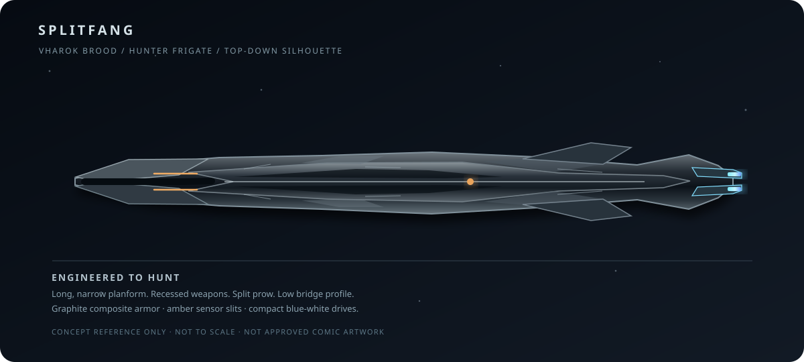

# The Vharok Brood

**Faction reference · owner-directed addition · 24 October 2026**

**Source:** Developed from the owner's supplied image of a black-scaled, amber-eyed predatory alien and the owner's direction that this civilization hunts and eats other intelligent species. The ship design direction is explicitly **more advanced, slimmer and more refined than standard Known Reach fleets**.

**Scope / spoiler warning:** This is an authorized **wider-setting faction concept**, not a claim that Chapters 1–8 have already identified this species. Its proposed connection to the Directorate's hidden war, the forgotten gates, Varek Solan's keys and the ancient *Saint Varos* records is a **future story direction**; the drafted Chapter 9 scenes have not been committed. Characters must discover these connections through evidence, not automatic knowledge.

> **Faction principle:** A civilization of predators that has made the hunt into economics, government, strategy and war.

## At a glance

| Field | Reference |
| --- | --- |
| Formal name | **The Vharok Brood** |
| Species | Vharok; intelligent, armored reptilian predators |
| Nature | Expansionist, organized predatory civilization |
| Primary objective | Capture territory, food supplies and viable populations; control strategic passage |
| Social structure | Brood Sovereigns, Claw Lords, Pack Speakers, Flesh-Shapers, hunter packs |
| Space territory | Parts of an older, poorly charted gate and relay network; full extent unknown |
| Main strength | Fast coordinated hunters; advanced slim-profile warships; disabling strikes and boarding |
| Main vulnerability | Heat and ammunition under prolonged pursuit; fragile supply and harvest chains; difficult close actions against disciplined counter-boarders |
| Defining ship shape | **Long, very narrow, low-profile, sharp and engineered** — never a bulky fortress, scrap hulk or Gothic cathedral |
| Thematic distinction | Garooth seize scrap; Seraph seize identities; **Vharok seize and consume living populations** |
| Narrative status | Owner-approved faction design; **not yet confirmed by characters in the committed novel** |

## 1. Physical appearance

Vharok look like a species for which physical predation never stopped shaping evolution. A mature hunter is broad across the shoulders and chest, with long powerful arms, grasping claws, thick corded muscle and a low, threatening head. Black, iron-grey and charcoal scales overlap across the body like natural armor. Raised ridges and short spines protect the skull, back and neck. Deep-set amber eyes catch light in near darkness.

Their jaws open wider than a human jaw, exposing rows of teeth suited to gripping and tearing. A Vharok does not need to shout to look dangerous. A quiet Vharok examining a room is often more unsettling than one showing its teeth.

They are **not** Garooth, altered humans, Seraph hosts or unthinking beasts. They are a separate species with advanced language, science, memory, culture and military planning. Their armor is organic tissue, not proof of invulnerability: concentrated gunfire, explosive pressure, vacuum, thermal injury and disciplined heavy weapons can kill them. Their senses are well adapted to low light and close pursuit, but jamming, environmental masking and deception can mislead them.

The owner's original creature image is the **anatomical reference**; it is not republished here as a repository asset.

## 2. Feeding and the meaning of prey

Vharok eat other species, including intelligent ones. This is both a source of nutrition and a foundation of their hierarchy. A defeated population may be divided into labor captives, technical prisoners, controlled breeding populations and food reserves. Whole worlds can be assessed as long-term food sources rather than simply conquered territory.

Not every raid is a feast. An interstellar civilization still needs ordinary logistics: preserved rations, protein production, nutrients for hatcheries, protected cargo holds, medical care and functioning reactors. Their appetite does **not** allow ships to violate supply limits.

The Vharok's greatest horror is deliberate policy. They can be patient, negotiate time-limited exchanges, preserve infrastructure and spare a settlement temporarily because a living population has greater future value to them than a ruined world.

For Vharok command, **capture is often the purpose of battle, not a side effect**.

## 3. Brood society

The political names below are readable translations used in human intelligence summaries, not yet confirmed native words.

- **Brood Sovereigns:** long-standing rulers of major brood domains, controlling expansion priorities and feeding rights.
- **Claw Lords:** fleet and campaign commanders whose authority depends on successful hunts and the ability to maintain their packs.
- **Pack Speakers:** coordinators, translators and tactical planners. They synchronize independent formations; they are not a telepathic hive mind.
- **Flesh-Shapers:** physicians, breeding specialists, genetic engineers and custodians of captured populations.
- **Hunters:** professional warriors, scouts, ship crews and boarding troops.
- **Nest Keepers:** administrators and logistics officers responsible for brood habitats, hatcheries, rations and transport.

Prestige follows successful acquisition and the ability to feed the brood. Physical dominance matters, but a commander who wastes precious ships or lets a food convoy fail can lose status more quickly than a spectacular duelist.

The Vharok possess laws and internal obligations, but those protections do not automatically extend to foreign species. The result is an advanced state built around a moral boundary most Known Reach civilizations cannot accept.

## 4. Technology and shipbuilding identity

**The Vharok are technologically advanced, not primitive raiders with better claws.** Their industries favor precise manufacture, compact engineering, high-efficiency sensors, recessed weapon mounts, tightly packed propulsion and strong electronic-warfare systems. Ships share components and maintenance standards across the Brood.

### Non-negotiable ship silhouette

**Make Vharok ships markedly slimmer and more advanced-looking than the corresponding ship type in conventional human fleets.**

- **Very long and narrow:** a blade, needle or hunting spear viewed from above; emphasize length rather than beam.
- **Low dorsal profile:** avoid tall towers, castle-like bridges, wide hangar blocks and stacked superstructures.
- **Tapered split prow:** two subtle forward mandibles can frame a central weapon or sensor channel; the prow never becomes a bulky animal head.
- **Refined surfaces:** overlapping gunmetal composite plates echo reptilian scales only in their small panel geometry. They are machines, **not organic or living ships**.
- **Hidden systems:** recessed sensors, launch hatches, weapon apertures and docking spines. Most machinery is flush until combat.
- **Narrow drive arrangement:** compact blue-white engine apertures and slim aft stabilizers, without giant exposed thruster farms.
- **Colors:** graphite black, dark steel and cold silver highlights; limited amber targeting slits that echo the species' eyes.
- **Visual comparison:** a House cruiser is heavily armored and broad; a Talyrn hull is dense and redundant; a Garooth ship is a welded bruiser; a Vharok equivalent is **sleek, elongated, controlled and predatory**.

Do **not** copy Seraph cathedral silhouettes, Garooth scrap construction, Talyrn broad hulls or the Sorynth's pale crescent identity. Vharok warships look like designed killing instruments built by a civilization with strong engineering discipline.

### Splitfang hunter-frigate — visual anchor

*Conceptual vector silhouette only; not an approved production model, scale drawing or final comic asset.*

See the [Splitfang-class hunter frigate dossier](../../fleet-classes/vharok-splitfang.md).

## 5. Fleet roles

Vharok forces retain the Known Reach's recognizable ship hierarchy. Their doctrine changes how each type is designed and used.

| Type / proposed family | Primary role | Design signature |
| --- | --- | --- |
| **Needlewake corvette** | Reconnaissance, pursuit and prey marking | Needle-thin, low-emission scout with short sprint capacity |
| **Splitfang frigate** | Escort hunting, drive suppression and boarding setup | Long forked prow, compact launch hatches, fast coordinated maneuvers |
| **Talonline destroyer** | Formation penetration and precision drive kills | Narrow gun spine and deep missile cells |
| **Nighttalon cruiser** | Pack coordination, independent raiding | Slender command hull with distributed sensors |
| **Dreadspine capital ship** | Heavy breakthrough and protected assault command | Long heavy keel, multiple recessed weapon channels; still slender in proportion |
| **Mawhold harvest carrier / tender** | Boarding forces, live-prisoner transport, repair and feeding logistics | Wider internal volume for mission needs, but smooth, tapered exterior |

These are **proposed family names and roles**, not a claim that all six have appeared in the published story. Avoid inflating them into unlimited fleets or unearned superweapons.

## 6. Fleet doctrine

### Whisper Range — Stalk

They observe from separate bearings. Scouts identify gate exits, convoy patterns, escort response times and valuable passenger compartments. False emissions and passive sensors obscure which ship will make the first attack. Vharok commanders do not confuse a sensor contact with confirmed prey.

### Hammer Range — Wound

Hunter groups combine their fire on drives, weapons control, sensors and communications. Their preferred result is a vessel too damaged to escape but intact enough to board. A split-hull frigate may distract the escort screen while a destroyer fires into the transport's propulsion.

### Knife Range — Take

Specialist boarding cutters approach from the damaged side, use short-range grapples and assault through selected access points. Boarding troops secure engine control, passage junctions, medical areas and captured-personnel routes. A ship carrying hundreds of potential prisoners is usually worth more to the Brood alive than as debris.

**Signature boarding doctrine — The Harvest Descent:**

1. **Mark:** identify the valuable occupants and the escape paths.
2. **Sever:** isolate the convoy and disable propulsion or signals.
3. **Pin:** suppress defenses and establish safe boarding vectors.
4. **Enter:** seize critical compartments with trained hunting teams.
5. **Collect:** transfer captives, archives, supplies and useful equipment.
6. **Withdraw:** leave before relief forces close the trap.

A commander may instead destroy a dangerous escort or hard target. The Brood's preference for captives is a strategic tendency, not a prohibition on lethal force.

## 7. Gate knowledge and territory

Vharok operations are associated with old and neglected transit corridors. Their advantage is **access**, not free teleportation: ships still need route knowledge, functioning gates, authentication, favorable arrival conditions and supply support. A preserved or stolen key can make a forgotten system accessible without making every locked gate vulnerable.

**Unknowns to preserve:** their original homeworld, exact age, full population, political unity, origin of their gate credentials and whether they fought the fleet later found at the Keros Grave. These mysteries need discoveries in the story, not retroactive declarations.

## 8. Strengths and limits

**Strengths:** sophisticated compact systems; fast and unusually slim warships; cooperative hunting patterns; disciplined capture operations; excellent pursuit tactics; experienced counter-escape doctrine; willingness to plan campaigns around populations and supplies.

**Limits:** thin hull profiles sacrifice some redundant armor and internal volume; long high-power pursuits strain heat capacity; narrow ships cannot carry limitless captives; hatcheries and harvest logistics require protected transports; separated pack elements can be isolated; stubborn counter-boarders can ruin a carefully timed capture.

A small, well-supported Vharok squadron is dangerous. It is not automatically superior to an entire trained House or Talyrn fleet.

## 9. Relationships and narrative contrast

**Directorate of Ash:** proposed ongoing opponent on the forgotten-gate frontier. The Directorate's secrecy and possible abandoned civilian systems could conceal the Brood's advance. Confirmation belongs to future scenes and verified evidence.

**House von Hjertstedt:** direct violation of the Charter of Steel's protection of civilians and opposition to predation. The House must still identify targets, rescue captives, gather evidence and avoid unnecessary destruction.

**Talyrn Continuance:** Talyrn rescue and distributed command complicate Vharok attempts to isolate and harvest individual vessels.

**Seraph Throne:** distinct threat. Seraph rulers want bodies as hosts and institutional control; Vharok rulers want populations as prey, labor and food. The two must not be presented as the same species or conspiracy by default.

**Garooth Clans:** both are predatory but for different reasons. Garooth take metal, wreckage and a good fight. Vharok systematically select and capture living prey with well-maintained, advanced warships.

**Terran Protectorate / other human states:** a possible common enemy, but diplomatic reactions and the extent of anyone's knowledge remain story-dependent.

## 10. Story connection and revelation guardrails

**Intended future hook:** unknown slender, split-hull contacts in recovered *Saint Varos* records may correspond to ships reported at a covert Directorate war front. Varek Solan's secured device may contain old gate authentication keys relevant to that war.

This **does not** retroactively make the unfinished Chapter 9 drafts published novel canon. Keep the keys in lawful Winge custody. Aster-9 can help interpret old archives; Vintermind can offer secured comparisons; neither should instantly unlock every relay or invent missing history.

Suggested revelation path:

1. Reports of vanished colonies and strange disciplined ship formations.
2. Analysis of intact wreckage, lost-gate maps and testimony from survivors.
3. A first confirmed encounter with Vharok hunters and their prey-capture doctrine.
4. Discovery of the civilization behind the raiding lines, its supply system and its true strategic scale.

## 11. Canon guardrails

- **Advanced, narrow, sleek warships** are a required visual distinction. No bulky scrap hulks or ceremonial Gothic battleships.
- The species is **intelligent and civilized by its own standards**, not a mindless animal horde.
- They consume other sapient species and may hold captives as food sources. That is not a Seraph host system or a Garooth salvage economy.
- Their hunting practices are horrific, but do not turn them into an invulnerable supernatural force.
- Travel remains dependent on gates, lanes and authentication; lost gates never equal unlimited instant movement.
- Retain the ordinary fleet hierarchy and readable Whisper / Hammer / Knife combat language.
- Their connection to the Directorate's secret war is the owner's story direction, **not an event proven by currently committed Chapters 1–8**.
- The artwork and ship-family names in this README are concept references, not retroactive publication or final approved comic designs.

---

**One-line faction definition:** **The Vharok Brood is a technologically advanced civilization of armored reptilian hunters whose long, slender warships stalk forgotten gates, cripple enemy fleets and capture entire populations to feed a predatory empire.**
